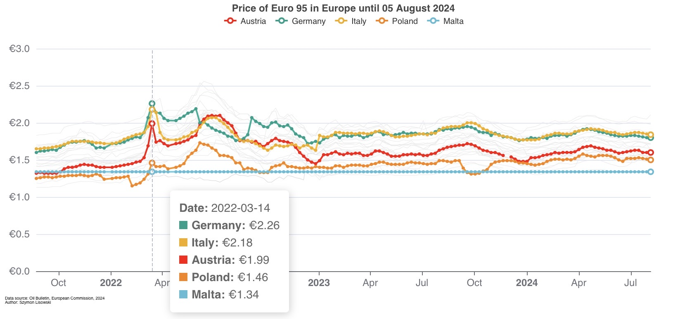

# Fuel Prices in Europe

<a href="https://vosbrucke.shinyapps.io/fuel-prices-in-europe/" target="_blank">
  
</a>

This repository contains an interactive Shiny dashboard for exploring fuel prices across European countries and zones. It was created to address a common issue in public reporting: changes in oil and fuel prices can often be discussed missing historical context which can lead to misleading assumptions about price level developments. The project also highlights how national regulations and market specific structures shape pricing across Europe. The dashboard turns weekly fuel-price data into a practical analytical tool for comparing markets, tracking relative changes, and visualising the geographic distribution of fuel costs.

The deployed app is available here: https://vosbrucke.shinyapps.io/fuel-prices-in-europe/

An example output:


## What the dashboard covers

The app is built around a single global fuel selector and a set of views that allow users to:

- compare price trends over time for multiple countries or zones,
- switch between raw price levels and relative price indexes,
- view a Europe-wide map of current or relative prices,
- inspect country-level snapshots against multiple time horizons,
- review a bar chart of current prices by market,
- explore relative change patterns through a heatmap,
- display and filter market notes and commentary attached to specific dates.

In practical terms, the dashboard answers questions such as:

- which countries are relatively expensive or cheap today,
- how a country compares with its regional peers,
- how quickly prices have moved over the past week, month, or year,
- how the latest prices are distributed across Europe.

## Main dashboard views

### 1. Price trend chart

This is the main analytical view of the app. It lets the user:

- choose a fuel type,
- select one or more countries/zones,
- choose a date range,
- switch between absolute price trend and relative price index mode,
- enable market notes that appear as vertical markers on the chart.

### Annotations and market notes

The dashboard also supports date-based annotations, which are short market notes or commentary items attached to specific points in time. These annotations can be toggled on in the trend and index views and are shown as vertical markers on the chart. The notes are filtered by the selected fuel and date range, so only relevant market commentary is displayed for the current analysis.

The annotation dataset is stored in the repository as `Data/annotations.csv`. Each row typically contains a date, a fuel reference, and the associated note text. When users highlight a marked date, the app displays the matching commentary alongside the chart so that major market events can be interpreted in context.

### 2. Price on a map

This tab places the selected fuel on a Europe map. It supports:

- current-price or relative-change view,
- date selection for the comparison snapshot,
- highlight selection for chosen countries,
- optional country labels.

### 3. Price bar chart

This view compares country prices in a bar format at a chosen reference date, with regions and value formatting for quick market comparison.

### 4. Relative change tracking

A heatmap-style chart summarises relative price changes by country across multiple time windows. This gives a compact view of which countries are becoming more or less expensive over different periods.

## Repository structure

```text
.
├── Data/
│   └── oil_bulletin_long.csv
│   └── annotations.csv
├── R/
│   └── Shiny.R
├── README.md
├── DESCRIPTION
└── .gitignore
```

## How to run locally

Open the project in R and source the app script:

```r
source("R/Shiny.R")
shinyApp(ui, server)
```

## Data source

The project uses weekly fuel-price data from the Oil Bulletin published by the European Commission. The raw source is stored in the repository as a long-format CSV file in the Data folder and gets updated automatically each Monday.

The dashboard also loads market annotations from `Data/annotations.csv`, which help contextualise specific dates with short notes on price shocks, policy changes or other relevant market developments.
